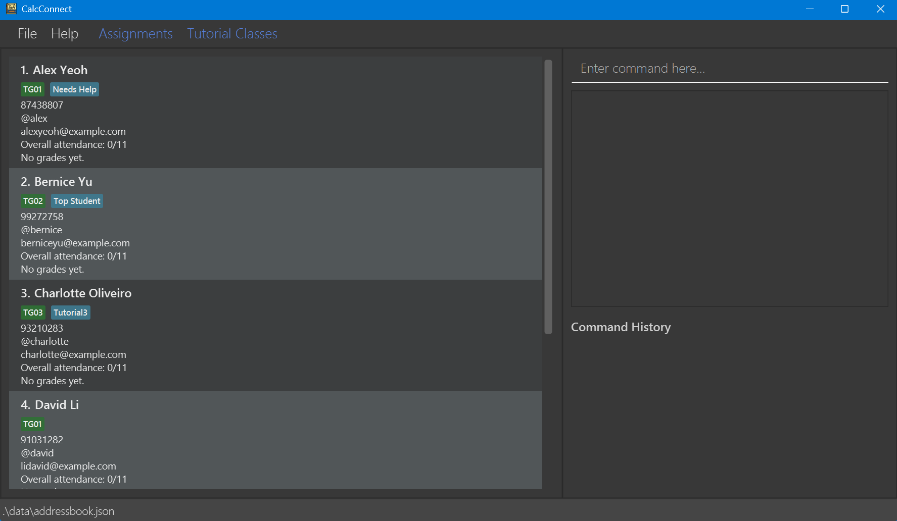

## CalcConnect: extending a CLI without losing its structure

CalcConnect was my CS2103T team project from September to November 2025. We
adapted AddressBook Level 3 into a desktop tool for teaching assistants managing
MA1521 students. The interaction stayed keyboard-first: commands add and edit
students, record grades and tutorial attendance, find or sort the cohort, and
persist everything to a local JSON file. JavaFX provides the interface, but the
command language is the main product surface.

Working from an existing codebase was the point of the project. We could not
simply place new logic wherever it was convenient. A feature normally crossed
the parser, command, model, storage, UI, tests, and documentation, and it had to
fit the dependency direction already established by the application.

## The inherited architecture

The codebase separates four main components. The UI owns JavaFX windows and
FXML views. Logic parses a command string and executes a command against the
model. The model owns students and the filtered/sorted observable list. Storage
serialises that state to JSON. The UI depends on Logic rather than manipulating
student records directly, and commands depend on the Model interface rather
than on JavaFX controls.

That separation made additions slower at first but easier to reason about. A
new command needed an explicit grammar and error messages, and its behaviour
could be tested without starting a window. UI-only state could use JavaFX
observable collections without leaking into the persisted address book.

The build used Java 17, Gradle, JUnit 5, Checkstyle, JaCoCo, and GitHub Actions.
The final JAR bundled JavaFX dependencies for the supported desktop platforms.

## Sorting as a vertical feature

The largest command feature I implemented was `sort`. It accepts a field—name,
tutorial group, grade, or attendance—and an optional ascending or descending
order. With no arguments it defaults to name ascending. The parser normalises
case and whitespace, recognises the optional verbose suffix used elsewhere in
the application, and rejects extra or unknown arguments with command-specific
usage text.

The command maps the selected field to a `Comparator<Person>`. Name sorting is
case-insensitive, tutorial groups use their numeric group value, grades use the
computed overall grade, and attendance uses the calculated attendance rate. A
descending request reverses the selected comparator before passing it to the
model's sort operation.

I added parser tests for valid aliases, defaults, whitespace, case, verbose
mode, invalid fields, invalid order values, and extra arguments. Command tests
then exercised all four fields in both directions, plus empty and one-student
models. Keeping parsing and execution tests separate made failures much easier
to locate.

## Making a command-driven UI easier to operate

I also built the command-history panel. A `CommandHistoryManager` owns a JavaFX
`ObservableList<String>` with the newest command first. `MainWindow` adds a
successful command after execution, and a list view reacts to the observable
collection through custom command cards. History is session-only by design; it
helps repeat and inspect work without changing the saved student data.

The integration exposed a subtle case: cancelling `clear` is a valid execution
path, but it should not look like a destructive command ran successfully. The
window therefore leaves cancelled clears out of history. The clear command
itself asks for confirmation through an injected `ConfirmationProvider`, with
the normal constructor bound to a JavaFX alert. Tests can pass a deterministic
provider instead of trying to drive a modal window.

Other UI contributions followed the same principle of making the command
language discoverable. I expanded the help window, added assignment and tutorial
class popups with F2/F3 shortcuts, displayed attendance and grades directly on
student cards, and added confirmation warnings to permanent deletion paths. I
also extended `find` beyond names to cover email, Telegram handle, and tutorial
group fields.

## Integration was the real assignment

CalcConnect was built by several people in parallel, so most difficulty came
from integrating changes across shared types. Grades and attendance were not
just new labels: they changed the student model, JSON adaptation, sample data,
commands, verbose rendering, diagrams, and tests. A parser change could collide
with another feature registering its own command. FXML and controller changes
could compile while still failing only when JavaFX loaded the view.

Small, reviewable commits and CI mattered more here than in my earlier projects.
Checkstyle caught inconsistent APIs before review, unit tests protected command
behaviour during merges, and the user and developer guides had to change with
the implementation because the command syntax was part of the contract.

## Limits and lessons

The application is deliberately local and single-user. JSON persistence makes
it reliable without a network, but there is no shared roster, concurrent edit
handling, or integration with a learning-management system. Those would require
a different storage and synchronisation design rather than another command.

The most useful lesson was how to add behaviour to an established architecture.
Renaming a concept or adding one field can cut across every component; forcing
it through explicit interfaces and tests is slower than patching the UI, but it
keeps the next change understandable. CalcConnect made that trade-off concrete.
