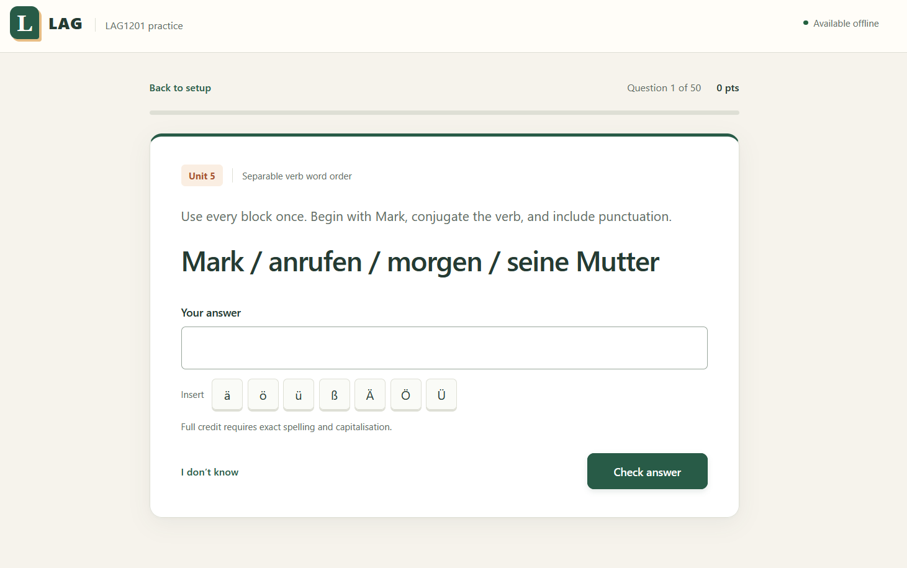

## LAG: German revision with fewer places to hide

Recognising a German word on a vocabulary sheet is a very different experience
from being asked to type it, remember its article, produce the plural, and put
the verb in the right place. The sheet is surprisingly forgiving when the
answer is sitting right next to the question.

I built LAG around the material for LAG1201. It turns the glossary, lesson
content, and assessment-style exercises into focused practice sessions. Pick
the units, choose a focus, and answer the questions. Study mode gives feedback
immediately. Exam mode keeps corrections until the end, with a review screen
and the option to retry mistakes.

The app runs entirely in the browser and can be installed as a PWA. After its
initial online setup, the questions, grading, and cached listening recordings
work offline. There is no account to create or grading server to wait for.
German already provides enough friction.

## The curriculum is part of the application

The current bank covers Units 0 to 7, including 624 glossary entries, 109
conjugation-table exercises, 157 grammar drills, 75 full-sentence exercises,
and 174 semester-test practice items.

Those are different kinds of work. A noun question may ask for an article, a
singular, a plural, or both forms. A conjugation table has seven pronoun rows
with separate feedback. Sentence tasks check word order and grammatical forms.
Semester practice includes listening and reading context alongside the answer
field.

The glossary is generated from the source workbook, while authored exercises
carry source references and reasoning tips. Curriculum data stays separate
from the quiz engine. Adding a unit should expand the question bank without
requiring another branch of interface logic for every new word.

Stable content IDs also matter. Exposure history belongs to a particular
entry or question variant, so regenerating the data must not casually turn
everything the user has practised into something the app thinks is new.

## Random questions can still make a bad quiz

A naive shuffle can ask for the English translation of a word, its German
translation, its article, and its gender counterpart in one session. Four
cards, very little extra coverage, and several opportunities to remember the
answer from thirty seconds ago.

LAG groups related entries and question variants into families. A quiz selects
at most one question from each family, then rotates through the less-used
entries and formats across sessions. It favours unseen material and older
exposures, with a recent-use cooldown to reduce immediate repetition.

The sampler also distributes questions across the selected categories.
Semester sections get their own buckets, so a sufficiently long session can
cover the available sections instead of accidentally becoming twenty article
questions. The requested length is capped by the number of distinct available
families.

These are explicit sampling rules. Wrong answers do not automatically take
over every future quiz. Retrying mistakes is a separate choice on the results
screen, leaving normal practice focused on covering the material.

## Being forgiving in the right places

Grading is where a small quiz app starts needing actual domain rules.

For ordinary vocabulary, exact spelling and capitalisation earn full credit.
Capitalisation-only mistakes earn partial credit, as do German-character
substitutions and small spelling errors. Unicode and whitespace are normalised
before comparison, so an irrelevant representation difference does not become
a learning mistake.

That same fuzzy matching would be wrong for several other question types.
A telephone number with one incorrect digit is still the wrong telephone
number. A valid conjugation for a different pronoun is a grammar error.
Changing a sentence ending can change the grammatical form rather than merely
introduce a typo.

The grader therefore handles structured answers separately. Telephone digits
must match. Conjugation tables grade each row and reject another person's
valid form. Sentence tasks accept their listed answers, with limited allowances
for capitalisation, German characters, and final punctuation, rather than
giving edit-distance credit for incorrect word forms.

This does constrain the product: sentence practice follows the requested
opening and phrase order. It is not an unrestricted German essay marker.
Semester practice also uses its own per-card scoring rather than claiming to
reproduce the official assessment's marking scheme.

## Offline includes the next release

The client uses native JavaScript modules, HTML, and CSS. There is no frontend
build step or runtime dependency tree. NGINX serves the files, and a service
worker caches the application, curriculum, and sample listening recordings.

The less obvious problem is updating an installed copy. A new interface paired
with an old cached question engine can offer units that the engine does not
understand. An activated service worker also does not replace JavaScript
modules that an open page has already imported.

The release strategy keeps the HTML, modules, styles, and data on a matching
version. The worker installs the complete shell before taking over and serves
the app from that release's cache. Setup can refresh automatically, but an
active quiz or results review gets an explicit reload action so the update
does not discard answers halfway through a session.

Listening exercises need more than a cached MP3, too. Audio players request
byte ranges when seeking. The worker serves those ranges from the complete
cached recording, allowing playback and seeking without a network connection.

## A small client, with deployment taken seriously

The deployment uses an unprivileged NGINX container and Kubernetes manifests.
GitHub Actions runs syntax checks and tests, validates the manifests, and
smoke-tests the production container. Releases publish an image and update the
homelab's GitOps repository with an immutable image tag for Argo CD to reconcile.

The tests cover the rules that are easy to break quietly: curriculum
boundaries, family uniqueness, accepted answers, structured grading, offline
audio ranges, and upgrades from stale caches. Sampling accepts an injected
random source, so a failure can be reproduced instead of disappearing on the
next run.

## Where it stands

LAG supports vocabulary, grammar, conjugation, sentence, and semester-test
practice, with local exposure tracking and answer review. Progress belongs to
the current browser and device. There is no cross-device account sync, and
refreshing an active quiz returns to setup because the session itself lives
in memory. Speech recognition and semantic grading remain future work.

The most interesting part of this project is how much behaviour lives behind
a question and a text box. Which question comes next, what counts as a
mistake, and whether an update interrupts a session all affect whether the
app is useful. Keeping the frontend small left room to be precise about those
decisions.
