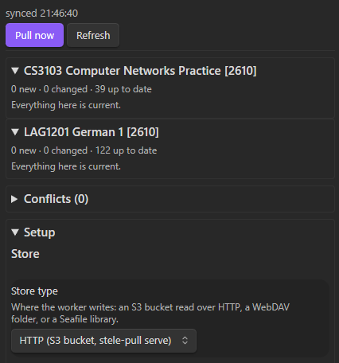

## Stele Pull: getting the course files out of Canvas

Canvas is where the course materials live. Obsidian is where I want to work
with them. In between sits the very exciting job of opening each course,
finding the files, downloading them, putting them in the right folders, and
doing it again when a lecturer uploads a revised copy.

Stele Pull handles that pipeline. It brings Canvas course files into an
Obsidian vault, preserves their folder structure within each course, and lets
each device choose what it actually wants to keep. New files are previewed and
pulled explicitly. Once a file is in the vault, background pulls can keep it
updated without quietly filling the device with everything else.

It is also **phase one of Obsync**, my three-phase project towards a self-hosted
Obsidian sync and collaboration platform. Phase one gets external course
materials into the vault. Phase two concerns synchronisation across my own
devices, and phase three targets multi-user collaboration. Those later stages
bring different consistency problems. Stele Pull has a deliberately narrower
job: move files in one direction, and make every decision explainable.

## Two ways into the same vault

The hosted path has three parts. A Go worker reads Canvas on a schedule and
publishes files to an S3-compatible object store, backed by Garage. A TypeScript
Obsidian plugin reads that store and applies the device's own selection and
exclusion rules before writing anything locally. Kubernetes runs the worker as
a CronJob.

The store sits between ingestion and consumption, so each device does not need
to repeat the same Canvas downloads. A laptop can keep the full collection
while a phone skips large recordings. The plugin can calculate its preview
from the catalogue it already has.

There is also a direct Canvas mode for anyone who does not want to run the
worker and storage infrastructure. It feeds the same consumer sync loop, with
path behaviour checked against shared fixtures so switching modes does not
rearrange the vault. Its Canvas token stays in Obsidian's per-device secret
storage rather than the settings file that travels with the vault.

## A catalogue has to include the things you skipped

The most useful design decision is that the manifest describes everything
Canvas lists, including files the worker did not download. Entries distinguish
stored, skipped, locked, failed, and deleted files. A skipped entry carries the
rule and reason behind the decision.

That sounds like bookkeeping until a PDF you can clearly see in Canvas fails
to appear in Obsidian. Without that information, the user has to guess whether
the file was filtered, not yet released, or lost somewhere in the pipeline.
Here, the panel can say what happened. Changing a local filter can update the
preview immediately because the missing information was never thrown away.

The worker's rules are broad storage limits. More opinionated choices belong
on the device, where reversing one is cheap. Skipping videos on a phone should
not decide what the laptop is allowed to download.

## Publishing a complete version

Files in the store are addressed by their SHA-256 hash. Identical bytes can
share a blob even when they appear under different paths. Each run writes a
separate manifest, then updates the course's `latest` pointer only after the
required writes have finished.

That pointer is the publication boundary. If the worker crashes before moving
it, consumers keep reading the previous manifest. There may be unreferenced
objects to clean up later, but the unfinished run has not become the version
everyone sees. A failed refresh of an existing file also preserves its previous
stored version, records the failure, and leaves it eligible for another attempt.

Canvas does not supply the content hash this design needs through its normal
file API. Change detection therefore starts with file identity and metadata,
then hashes the downloaded bytes. A short download is rejected rather than
being promoted to the new stored copy.

The important limit is that publication assumes a single writer. Garage 2.3.0
does not enforce the conditional object creation needed for a fully exclusive
lease. The implementation probes that behaviour and reports the weaker
guarantee. Kubernetes prevents overlapping scheduled runs, but manual pulls
still need to avoid racing them. That is a real constraint of this version.

## The vault belongs to the user

A mirror becomes much less convenient if it overwrites an annotated file.
Before replacing a local copy, the plugin checks it against the content it
previously wrote. Local changes go through conflict handling. Files removed
from Canvas move to trash rather than being permanently deleted.

The selection behaviour matters just as much. Automatic pulls refresh existing
selected files, but do not introduce new ones or restore files the user deleted
from the vault. Those need an explicit pull. Unticking a file survives restarts.
The background job should not spend its time undoing the user's choices.

Large downloads have a separate constraint: Obsidian's HTTP API buffers
responses. The plugin uses byte-range requests and appends chunks to a temporary
file, keeping the download buffer bounded by the chunk size. In store mode,
the completed content must match the manifest's hash before it is moved into
place. Direct mode has no upstream hash to compare against, so its checks work
from the available Canvas metadata and downloaded bytes.

## Keeping Go and TypeScript in agreement

The worker and plugin share a protocol, even though they are written in
different languages. Both test suites read the same fixtures for policy
decisions, manifests, invalid inputs, store conventions, and Canvas paths.
Generated fixtures are checked for drift in CI.

That protects against a particularly annoying class of failure: both halves
passing their own tests while disagreeing about what the same data means.
Integration tests also exercise the S3 implementation against Garage, including
range reads and a complete worker pass. The plugin's sync tests use an
in-memory vault adapter to exercise file behaviour without launching Obsidian.

The CLI provides the other half of that visibility. It can list courses,
preview a pull, inspect run history, compare manifests, and stream a file with
hash verification. Content-addressed storage is useful, but a directory full
of hashes is a terrible debugging interface on its own.

## Where it stands

The worker, inspection CLI, store integration, and Obsidian plugin are
implemented, with CI and homelab deployment configuration alongside them.
Downloads in the worker are still serial, the Garage lease remains
best-effort, and this phase does not synchronise user edits between devices.

Stele Pull gives Obsync a useful first deliverable while keeping its promises
small enough to inspect. The interesting work turned out to be deciding what
a skipped file means, when a new version becomes visible, and how to respect
the copy already on disk. The download itself is only one part of the job.
