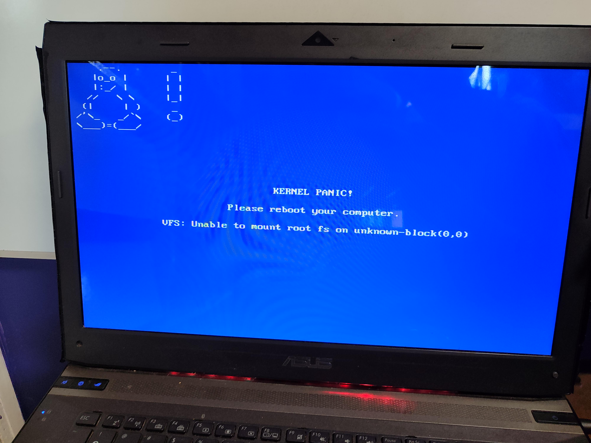
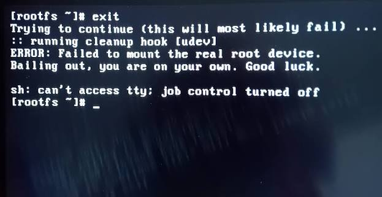

CS2106 is the GOAT. This is the module where the computer part of Computer Science shines.

Applications usually present a wonderfully tidy fiction. A program appears to start, own some memory, read a file and perform several tasks at once. CS2106 opens the floorboards and shows the machinery maintaining that fiction: the kernel, processes, scheduling, synchronization, virtual memory and file systems.

I was ecstatic. I even dual-booted Linux, which is either evidence that the module inspired me or that it damaged my judgment in a very specific way.

## Content overview

The module begins by explaining what an operating system is. It sits between programs and hardware, providing abstractions while allocating shared resources and enforcing protection. The kernel is not a vague spirit living inside the computer. It is privileged software that responds to system calls, handles interrupts and controls access to the machine.

Processes are the central abstraction. A running program has an address space, execution state and resources managed by the OS. Creating processes through `fork`, replacing their programs through `exec`, and waiting for them to finish makes the process lifecycle concrete. Once this model clicks, many behaviours in Linux stop looking like command-line folklore.

Threads introduce multiple flows of execution within a process. They make concurrency cheaper and communication easier because memory is shared, but shared memory also creates races. Two individually reasonable operations can interleave into a completely unreasonable result.

Semaphores, mutexes and condition variables provide ways to coordinate that execution. The code is often small; the state space is not. Synchronization requires you to reason about all the moments at which another thread might run, including the inconvenient one you forgot. Deadlock adds another charming possibility: every participant behaves according to the protocol and collectively achieves permanent inactivity.

The memory portion explains address translation, paging and virtual memory. Each process can behave as if it owns a large, private address space even though physical memory is shared and limited. The OS and hardware cooperate to translate addresses, enforce isolation and move pages between memory and storage when necessary.

Finally, file systems turn persistent storage into files, directories and metadata. Concepts such as file descriptors, inodes and allocation reveal that a filename is only the friendly surface of a deeper data structure.

## Why all of this matters

CS2106 builds a foundation for understanding the entire software stack. Processes explain how applications are isolated and scheduled. File descriptors connect naturally to pipes, sockets and network communication. Virtual memory explains segmentation faults, memory-mapped files and why an address printed by one process does not identify the same physical location in another.

Concurrency is even more widely useful. Servers handle many clients, game engines update several systems, renderers distribute work, and parallel programs coordinate shared state. Threads and synchronization are not niche operating-system trivia. They are the vocabulary required to reason about what happens when more than one thing progresses at once.

The module also gives Linux a coherent shape. The command line is no longer just a collection of utilities. Pipes connect process outputs to inputs. Permissions rely on kernel enforcement. `/proc` exposes process and kernel information through a filesystem-like interface. Signals, child processes and file descriptors become parts of one model.

Operating systems also carry a particularly rich history. Early computers ran one job with little abstraction. Batch systems improved utilisation, time-sharing let multiple users interact with a machine, and Unix refined ideas whose descendants remain visible in modern systems. The abstractions feel natural today precisely because decades of systems work made them ordinary.

## Apparently not everyone loves this

I had hoped more people would be enthusiastic about CS2106. The material felt like an explanation of questions I had always wanted to ask: what is actually running, who decides when it runs, and how does the machine stop one broken program from destroying everything?

Not everyone shared that excitement. I can see why. Concurrency is difficult, memory calculations can be tedious, and C exposes mistakes with very little sympathy. If your main interest is building user-facing applications, the details may initially seem far from the product.

But abstractions leak. A production program eventually encounters a race, a blocked process, exhausted descriptors, memory pressure or strange filesystem behaviour. At that moment, the operating system stops being background material.

## Verdict

CS2106 is a highly worthwhile introduction to computer systems. It does not make you a kernel engineer, but it gives you the mental models needed to understand how ordinary programs live on real machines.

It is especially valuable for systems, networking, security and the parallel-computing focus area, but I would recommend it much more broadly. Every programmer runs code on an operating system. Knowing what that sentence actually means is part of knowing computers.

*This review reflects the semester I took. Labs, assessments and topic emphasis can change.*
