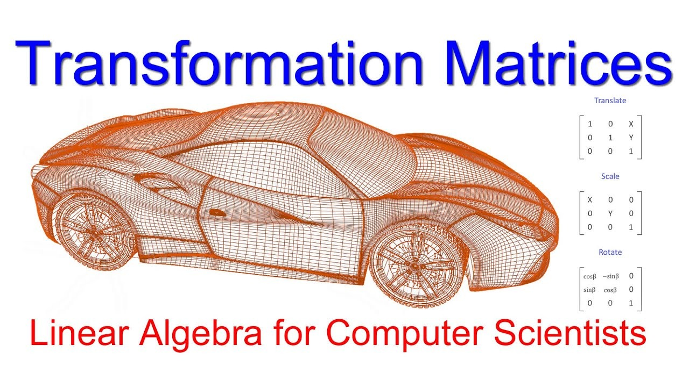

MA1522 was a goated module—but my recommendation comes with one very important condition: I took it with Prof Jonathon Teo.

Linear algebra can become an extremely dry sequence of row operations, matrix identities and definitions. He taught it intuitively enough that the symbols usually remained attached to an idea. That made the difference between memorising procedures and developing a model I could reuse.

I could also see the computing applications almost immediately. If calculus describes change, linear algebra provides much of the language used to represent spaces and transformations. For computer graphics in particular, this is foundational material.

## Content overview

The module begins with systems of linear equations and matrices. Gaussian elimination turns a collection of equations into a form from which solutions can be read, while matrix operations provide compact ways to express combinations of linear relationships.

Vectors are then treated as more than arrows in two- or three-dimensional space. A vector space is any collection of objects that follows the relevant rules for addition and scalar multiplication. Subspaces, span, linear independence and basis describe which directions or building blocks are genuinely needed. Dimension counts the size of a basis rather than the number of coordinates someone happened to write down.

Linear transformations map vectors while preserving the structure of addition and scaling. Matrices represent those transformations once bases have been chosen. Concepts such as rank and null spaces describe what information a transformation preserves or collapses. Orthogonality, projections and least-squares methods introduce geometry and approximation, while eigenvalues and eigenvectors identify directions that a transformation scales without rotating away.

Each topic adds another way to ask what a matrix actually *does*. It is not merely a rectangular calculator input. It can encode a transformation, a change of basis, a system of constraints or the relationships within data.

## Graphics is hiding everywhere

The connection to computer graphics is immediate. A point or direction can be represented as a vector. Matrices rotate, scale, shear and project geometry. Several transformations can be composed by multiplying their matrices, allowing an object to move through model, world, view and projection spaces before reaching the screen.

This is one reason linear algebra feels so satisfying: the equations can produce something visible. Change a transformation matrix and the object turns. Change the basis and the same geometric object receives different coordinates. Compute a normal incorrectly and the lighting looks wrong in a way that is both annoying and wonderfully concrete.

The ideas extend far beyond graphics. Linear systems appear in simulation. Projections and least squares support approximation. Eigenvectors describe stable directions and modes. Machine learning represents large collections of data and parameters through vectors, matrices and higher-dimensional arrays.

## Beyond the third dimension

Vector spaces become especially interesting after the third dimension because our visual intuition runs out while the algebra continues without concern. We can picture a plane in three-dimensional space. A subspace inside a hundred-dimensional feature space is less cooperative.

That is where the abstraction proves its value. The definitions do not require the space to fit inside a human skull as an image. Independence, basis, dimension and projection still work. We reason symbolically about structures that we cannot directly visualise.

This is a recurring theme in computer science. Computers operate comfortably on objects too large, fast or high-dimensional for us to inspect as a whole. Good mathematics gives us handles: properties that remain understandable even when the object itself exceeds intuition.

## The lecturer condition

My positive experience was strongly tied to Prof Jonathon Teo's teaching. He could take a procedure that looked arbitrary and explain the geometric or structural idea underneath it. Once you understand what information an operation preserves, the algebra becomes easier to reconstruct instead of memorise.

That also means this review should not be read as a permanent property of the module code. A different lecturer, assessment design or pacing could produce a very different experience. Module reviews often pretend that a course is a fixed product, but teaching is part of the product.

## Verdict

With Prof Jonathon Teo, MA1522 was highly recommended. The content is fundamental to graphics and useful across many computational fields, while the teaching made an abstract subject unusually intuitive.

Linear algebra eventually asks you to reason beyond what you can see. Oddly enough, a good lecturer makes that feel less like losing intuition and more like upgrading it.

*This review is specifically about the semester and lecturer I experienced. Check the current teaching team before using it as a planning recommendation.*
